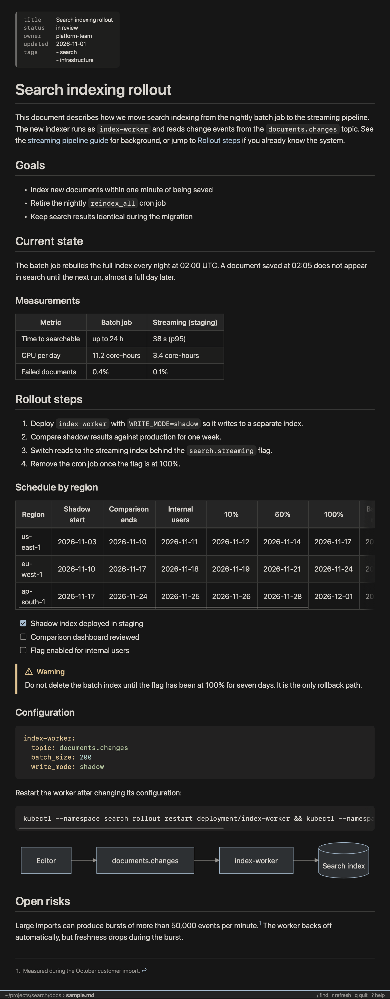
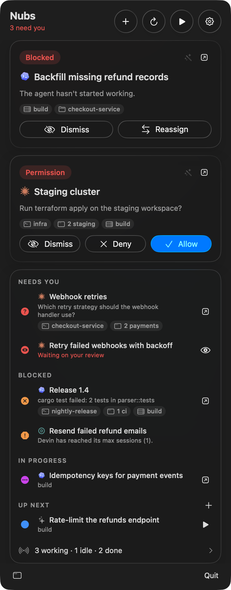

# rexworks

Extensions, scripts, tools, and plugins for Rex.

| Tool | Description | Install | Screenshot |
| --- | --- | --- | --- |
| [md-viewer](md-viewer/README.md) | Preview Markdown files clicked in any Rex terminal pane | `brew install good-banana/rexworks/md-viewer` |  |
| [Nubs](nubs/README.md) | See and manage the coding agents running in Rex sessions across servers, with a task board that automatically assigns work to agents | [Nubs.dmg](https://github.com/good-banana/nubs/releases/latest/download/Nubs.dmg) |  |
