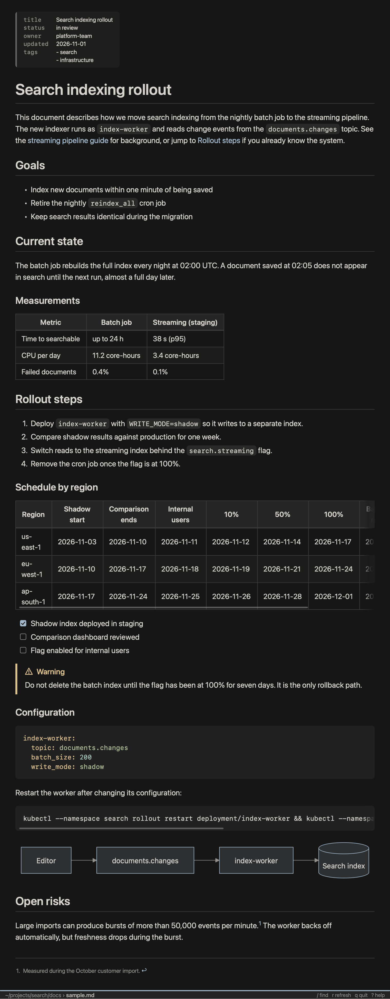
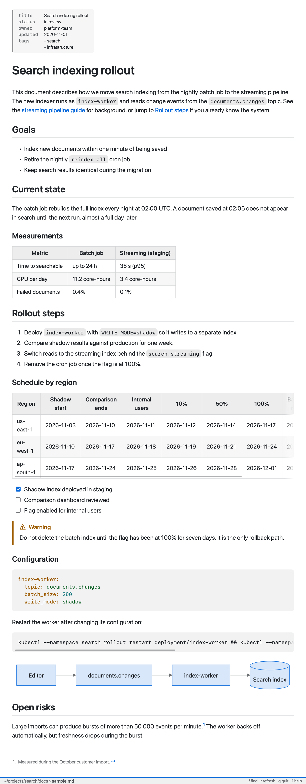

# md-viewer

`md-viewer` lets you preview Markdown files in a dedicated pane in Rex. Click a Markdown path in any Rex pane and a rendered preview opens in a pane beside it. The preview is drawn in the terminal using the kitty graphics protocol.

<p>
  
  
</p>

## Requirements

- macOS 14 or later
- Rex
- Xcode Command Line Tools with Swift 6 (Xcode 16 or later CLT). The formula builds from source.

## Install

```
brew install good-banana/rexworks/md-viewer && md-viewer setup
```

`md-viewer setup` installs the background handler app and makes it the default handler for Markdown files when you click them in Rex. Clicking a Markdown file in any other app will open it in your normal default Markdown app.

`md-viewer setup` installs a copy of the handler app, so rerun `md-viewer setup` after `brew upgrade md-viewer`.

## How routing works

- A click on a Markdown path in a Rex pane opens the preview beside that pane.
- Opens from any other app are forwarded to the Markdown app you used before running `md-viewer setup`.

## Keys

| Key | Action |
| --- | --- |
| j, Down | Scroll down |
| k, Up | Scroll up |
| d | Scroll down half a page |
| u | Scroll up half a page |
| Space, Page Down | Scroll down a page |
| b, Page Up | Scroll up a page |
| g, Home | Top |
| G, End | Bottom |
| r | Reload |
| Tab, Shift-Tab | Focus next or previous link |
| Enter | Follow the focused link |
| Esc | Clear link focus |
| Backspace, h | Go back |
| / | Search |
| n, N | Next or previous match |
| q, Ctrl-Q, Ctrl-C | Quit |

## Mouse

- Wheel scrolls.
- Click follows a link.

## Links

- Links to other Markdown files open in the preview. Backspace goes back.
- Web and mailto links open in your browser or mail app.
- Links to local files open only when the target is an image, audio or video, a PDF, or plain text. Scripts, apps, HTML, and SVG are blocked.

## Agents

Coding agents can open Markdown deliverables in a Rex preview pane. Run:

```
md-viewer agents install
```

This writes a small skill into each supported agent's skills directory, only where that agent is already installed:

| Directory | Agents |
| --- | --- |
| `~/.claude/skills/md-viewer/` | Claude Code |
| `~/.agents/skills/md-viewer/` | Codex, Pi, OpenCode, Devin CLI |
| `~/.cursor/skills/md-viewer/` | cursor-agent |

The skill tells the agent to run `md-viewer open FILE` after it writes or substantially updates a Markdown file for you. The preview opens beside the pane focused in Rex and reuses that tab's preview. The guidance ships in the binary (`md-viewer agent-guide`), so upgrading md-viewer updates it without rewriting the skill.

`md-viewer agents status` shows each directory as current, outdated, missing, skipped or foreign. `md-viewer agents remove` deletes only skills that md-viewer installed. `md-viewer setup` offers to install them, and `md-viewer uninstall` removes them.

## Commands

### Setup
```
md-viewer setup
```
macOS may ask you to confirm the change of default app for Markdown files.

### Doctor
```
md-viewer doctor
```
`md-viewer doctor` diagnoses the installation: handler app, highlighting and diagram resource bundles, and default handler registration.

The handler log is at `~/Library/Application Support/md-viewer/handler.log`.

### View Files
```
md-viewer view <file>
```

### Open Files
```
md-viewer open <file>
```

### Uninstall
```
md-viewer uninstall && brew uninstall md-viewer
```
`md-viewer uninstall` removes the handler app and restores the previous Markdown handler. macOS may ask you to confirm the change of default app for Markdown files.


## Credits

Vendored libraries and their licenses are listed in `Sources/MDViewerRender/Resources/THIRD_PARTY_NOTICES` (highlight.js) and `Sources/MDViewerMermaid/Resources/mermaid/THIRD_PARTY_NOTICES` (mermaid).

## Releasing

1. Tag with `git tag md-viewer-vX.Y.Z`, then push the commit and the tag to `good-banana/rexworks`.
2. Run `md-viewer/scripts/release.sh X.Y.Z`. It downloads the tag archive, computes its SHA-256, and writes `homebrew-rexworks/Formula/md-viewer.rb`.
3. Commit and push the `homebrew-rexworks` repository.

To test the formula before tagging, run `md-viewer/scripts/release.sh --local X.Y.Z`. It builds a tarball from `HEAD` and writes a formula with a `file://` URL to `$TMPDIR/md-viewer.rb`. That formula is for local testing only.
