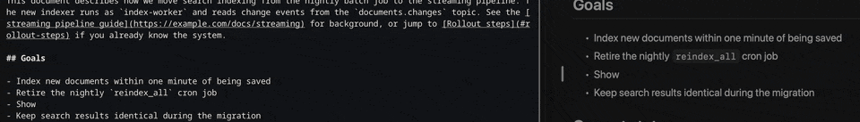
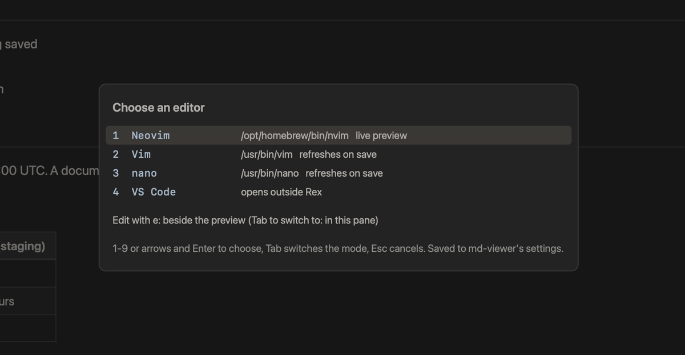
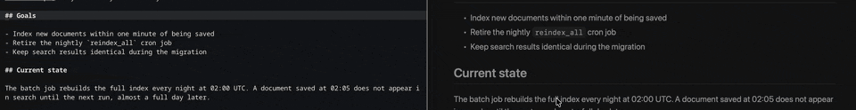
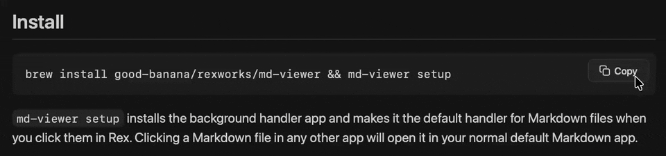

# md-viewer

`md-viewer` lets you preview Markdown files in a dedicated pane in Rex. Click a Markdown path in any Rex pane and a rendered preview opens in a pane beside it. md-viewer lays out and draws each page itself, then shows it in the terminal using the kitty graphics protocol. Its colors follow your Rex theme automatically, including when you switch themes or between light and dark.

<p>
  
  
</p>

## Features

- **Click to preview.** Click any Markdown path in any Rex pane, from `ls`, `git status`, a build log or a coding agent's reply, and the rendered page opens beside it. Click another and it opens in its own pane.
- **Real typography in the terminal.** Proportional fonts, true heading sizes, tables with header rows, syntax-highlighted code, task lists, footnotes, GitHub alerts like `[!NOTE]` and `[!WARNING]`, and frontmatter shown as a compact table.
- **Everything GitHub renders.** GitHub Flavored Markdown, the same safe HTML GitHub allows (centered logos, `<details>` sections, light and dark `<picture>` variants, side-by-side images), Mermaid diagrams, animated GIFs, SVGs and inline images.
- **A document, not a picture.** Select and copy text, copy code blocks with one click, find with `/` or Cmd-F, follow links and anchors with back and forward history, scroll wide code and tables sideways, and zoom.
- **Edit beside the preview.** Press `e` to open the file in your own editor in a pane beside the live preview, or `E` to edit in the preview's own pane. With Neovim the preview follows your cursor and shows unsaved text. md-viewer never writes your Markdown file.
- **Matches your Rex theme.** Every color comes from your current Rex theme and updates when you switch themes or between light and dark.
- **Stays in sync.** The preview reloads when the file changes and keeps your place, so you can watch a plan or README update as you or an agent edits it.
- **Works with coding agents.** One command teaches Claude Code, Codex, Pi, OpenCode, the Devin CLI and cursor-agent to open the Markdown they write for you in a preview.
- **Leaves everything else alone.** Markdown files opened from Finder or any other app still open in your usual editor.

## Requirements

- macOS 14 or later
- Rex
- Xcode Command Line Tools with Swift 6 (Xcode 16 or later CLT). The formula builds from source.

## Install

```
brew install good-banana/rexworks/md-viewer && md-viewer setup
```

`md-viewer setup` installs the background handler app and makes it the default handler for Markdown files when you click them in Rex. Clicking a Markdown file in any other app will open it in your normal default Markdown app.

`md-viewer setup` also adds a Cmd-F binding to your Rex config (`~/.config/rex/init.lua`, or the file `REX_CONFIG` names). It opens md-viewer's find in a preview pane and keeps Rex's normal Find everywhere else.

`md-viewer setup` also saves `$VISUAL` or `$EDITOR` from its environment as the `editor` setting, without asking, when no `editor` setting exists yet and the value names an executable. It prints which editor it saved and how to change it (`md-viewer config set editor <command>`). If neither is set, the preview asks you to choose an editor the first time you press `e`.

`md-viewer setup` installs a copy of the handler app, so rerun `md-viewer setup` after `brew upgrade md-viewer`.

## How it works

- A click on a Markdown path in a Rex pane opens the preview beside that pane.
- Opens from any other app are forwarded to the Markdown app you used before running `md-viewer setup`.

## Agents

Coding agents can open Markdown deliverables in a Rex preview pane. Run:

```
md-viewer agents install
```

This writes a small skill into each supported agent's skills directory, only where that agent is already installed:

| Directory | Agents |
| --- | --- |
| `~/.claude/skills/md-viewer/` | Claude Code |
| `~/.agents/skills/md-viewer/` | Codex, Pi, OpenCode, Devin CLI |
| `~/.cursor/skills/md-viewer/` | cursor-agent |

The skill tells the agent to run `md-viewer open FILE` after it writes or substantially updates a Markdown file for you. The preview opens beside the pane focused in Rex and reuses that tab's preview. The guidance ships in the binary (`md-viewer agent-guide`), so upgrading md-viewer updates it without rewriting the skill.

When you ask an agent to change how md-viewer edits, it runs `md-viewer config set editor <command>` or `md-viewer config set edit-mode split|here` instead of editing `config.json`. Agents do not open editor panes or run `md-viewer edit` unless you ask. If you save a file an agent is also writing, the agent's next write is refused because the file changed, and it re-reads the file rather than overwriting your saved changes.

`md-viewer agents status` shows each directory as current, outdated, missing, skipped or foreign. `md-viewer agents remove` deletes only skills that md-viewer installed. `md-viewer setup` offers to install them, and `md-viewer uninstall` removes them.

## Editing

Press `e` in a preview to edit the file it shows, in your own editor, without leaving Rex. md-viewer never writes your Markdown file; the editor does.

There are two modes:

- **Split** (the default). The editor opens in a Rex pane on the left of the preview, at 50% width, with focus. The pane is labeled `md-viewer-editor`.
- **Here.** The editor temporarily takes over the preview's own pane, and the preview comes back when the editor exits.

<p>
  
</p>

`e` runs the mode set by `edit-mode` (`split` unless you change it). `E` (Shift-E) runs the other mode. The editor opens at the line of the current selection, or at the line at the top of the view. `,` opens a picker listing the editors md-viewer finds on your `PATH`. Tab in the picker switches the mode, and choosing an editor saves it as the `editor` setting together with the mode shown.

<p>
  
</p>

### Choosing the editor

md-viewer uses the first of these that names an installed editor:

1. The `editor` setting.
2. `$VISUAL`, then `$EDITOR`, from md-viewer's own environment.
3. `$VISUAL`, then `$EDITOR`, from your login shell.

If the `editor` setting names a command that cannot be found, md-viewer stops there and shows a message instead of trying the others. If none of the three is set, pressing `e` opens the picker. The setting may include arguments, such as `nvim -u NONE`. md-viewer recognizes the editor from the command name; set `editor-kind` to override that. `md-viewer config` shows which editor is in use and where it came from.

| Editor | Command names | Where it runs | Preview sync |
| --- | --- | --- | --- |
| Neovim | `nvim` | Rex pane | Live |
| Vim | `vim`, `vi`, `view` | Rex pane | Refresh on save |
| Helix | `hx`, `helix` | Rex pane | Refresh on save |
| Emacs | `emacs`, `emacsclient` | Rex pane, in a terminal | Refresh on save |
| nano | `nano` | Rex pane | Refresh on save |
| micro | `micro` | Rex pane | Refresh on save |
| Kakoune | `kak` | Rex pane | Refresh on save |
| Any other terminal editor | anything else | Rex pane | Refresh on save |
| VS Code | `code`, `code-insiders` | Outside Rex | Refresh on save |
| Cursor | `cursor` | Outside Rex | Refresh on save |
| Zed | `zed` | Outside Rex | Refresh on save |
| Sublime Text | `subl` | Outside Rex | Refresh on save |

Every editor opens at the line you were looking at.

### Neovim live sync

Live sync needs Neovim 0.9 or later. With it, the preview and the editor stay linked in both directions:

- The preview follows the editor's cursor.
- The preview shows the editor's unsaved text. If the file also changes on disk while you have unsaved edits, the preview says so and keeps showing your unsaved text.
- Clicking in the preview moves the editor's cursor to that spot.

<p>
  
</p>

md-viewer writes the plugin that does this to its own support folder and loads it only into the Neovim it starts, so your own Neovim configuration is not touched. `md-viewer doctor` checks the installed Neovim version.

### Other editors

Helix and every other terminal editor open at the line and refresh the preview each time you save. VS Code, Cursor, Zed and Sublime Text are launched at the line and never get a pane, and never take over the preview's pane, whichever of `e` and `E` you pressed. The preview stays live and refreshes on save.

### Changes from agents and other tools

If an agent or another program changes the file while you are editing, the preview shows the change as soon as it is on disk. Neovim reloads the buffer on its own when it has no unsaved edits, and asks you what to do when it does. Other editors do their own thing. In Helix run `:reload` (or `:reload-all`) to pick up the change. Vim reloads on focus when `autoread` is set.

### Closing

When the preview closes, the editor pane stays open, because it may hold unsaved work. When the editor exits, the preview stays open, including a preview opened by `md-viewer edit`.

### Multiple previews

Within one Rex session there is one editor per file. Pressing `e` or `E` in any preview of a file that already has an editor focuses that editor instead of opening a second one. With Neovim, live sync follows the preview where you last pressed `e`.

## Commands

### Setup
```
md-viewer setup
```
macOS may ask you to confirm the change of default app for Markdown files.

### Doctor
```
md-viewer doctor
```
`md-viewer doctor` diagnoses the installation: handler app, highlighting and diagram resource bundles, and default handler registration. It also reports the editor md-viewer would use, where it came from, its kind and whether it syncs live or refreshes on save, plus the current `edit-mode`. For Neovim it checks the version and reports whether live sync is supported (0.9 or later). If the `editor` setting names a command that cannot be found, doctor reports a failure.

The handler log is at `~/Library/Application Support/md-viewer/handler.log`.

### View Files
```
md-viewer view <file>
```

### Open Files
```
md-viewer open <file>
```

### Config
```
md-viewer config
md-viewer config get <name>
md-viewer config set <name> <value>
md-viewer config unset <name>
```
`md-viewer config` shows each setting with its effective value and whether it comes from a setting, a default or detection, then how the editor resolves and which editors it found. `get` prints one value, `set` validates and saves it, and `unset` removes it. The names are `previews`, `edit-mode`, `editor` and `editor-kind`; see [Settings](#settings).

### Edit
```
md-viewer edit [--here] [--line N] <file>
```
Opens the file's preview, or reuses the one that is already open, then starts editing from it. `--here` runs the mode other than your `edit-mode`, as `E` does. `--line N` starts the editor at line N (the default is 1).

### Uninstall
```
md-viewer uninstall && brew uninstall md-viewer
```
`md-viewer uninstall` removes the handler app, restores the previous Markdown handler and removes the Cmd-F binding from your Rex config. It also deletes md-viewer's support folder, which holds the Neovim plugin, its sockets and sidecars, the editor files and your settings. macOS may ask you to confirm the change of default app for Markdown files.

## Settings

Change settings with `md-viewer config`, the editor picker (`,`) or `md-viewer setup`. Editing `~/Library/Application Support/md-viewer/config.json` by hand also works, but is never required.

| Name | Values | Default | Meaning |
| --- | --- | --- | --- |
| `previews` | `perFile`, `single` | `perFile` | `perFile` gives each file its own preview pane. `single` keeps one preview per tab that switches to each file you open. |
| `edit-mode` | `split`, `here` | `split` | What `e` does: edit beside the preview, or in the preview's pane. `E` does the other. |
| `editor` | a command | none | The editor to use, with any arguments. When unset, md-viewer uses `$VISUAL` or `$EDITOR`. |
| `editor-kind` | `neovim`, `vim`, `helix`, `emacs`, `nano`, `micro`, `kakoune`, `vscode`, `cursor`, `zed`, `sublime`, `terminal` | detected | Overrides how md-viewer treats the editor, for a wrapper script or an unusual command name. |

```
md-viewer config set editor nvim
md-viewer config set edit-mode here
md-viewer config unset editor
```

`config set editor` fails if the command cannot be found.

## Mouse

- Wheel scrolls. Shift+wheel or a sideways swipe scrolls a wide code block or table.
- Click follows a link, opens or closes a details section, or copies a code block with its Copy button.
- With Neovim beside the preview, click also moves the editor's cursor to the spot you clicked.
- Drag selects text. Double-click selects a word, and triple-click selects a paragraph, list item or table cell.

<p>
  
</p>

## Links

- Links to other Markdown files open in the preview. Backspace goes back.
- Web and mailto links open in your browser or mail app.
- Links to local files open only when the target is an image, audio or video, a PDF, or plain text. Scripts, apps, HTML, and SVG are blocked.

## Keys

| Key | Action |
| --- | --- |
| j, Down | Scroll down |
| k, Up | Scroll up |
| d | Scroll down half a page |
| u | Scroll up half a page |
| Space, Page Down | Scroll down a page |
| b, Page Up | Scroll up a page |
| g, Home | Top |
| G, End | Bottom |
| Tab, Shift-Tab | Focus the next or previous link, details section, code block or wide table |
| h, l, Left, Right | Scroll the focused code block or table sideways |
| Enter | Follow the focused link, open or close the focused details section, or copy the focused code block |
| c | Copy the focused code block |
| Esc | Close find, then clear the selection, then clear focus |
| Backspace, h | Go back |
| L, Shift-Backspace | Go forward |
| /, Cmd-F | Find (Cmd-F works through the Rex binding that `md-viewer setup` installs) |
| n, N | Next or previous match |
| y, Cmd-C | Copy the selection as plain text |
| Y | Copy the selection as Markdown |
| Cmd-A | Select everything |
| +, -, 0 | Zoom in, zoom out, reset zoom |
| e | Edit the file in the mode set by `edit-mode` (beside the preview by default) |
| E | Edit in the other mode |
| , | Choose the editor |
| r | Refresh: reload the file and re-read the theme |
| ? | Show all keys and mouse actions |
| q, Ctrl-Q, Ctrl-C | Quit |

## Credits

Vendored libraries and their licenses are listed in `Sources/MDViewerRender/Resources/THIRD_PARTY_NOTICES` (highlight.js) and `Sources/MDViewerMermaid/Resources/mermaid/THIRD_PARTY_NOTICES` (mermaid).

## Releasing

1. Tag with `git tag md-viewer-vX.Y.Z`, then push the commit and the tag to `good-banana/rexworks`.
2. Run `md-viewer/scripts/release.sh X.Y.Z`. It downloads the tag archive, computes its SHA-256, and writes `homebrew-rexworks/Formula/md-viewer.rb`.
3. Commit and push the `homebrew-rexworks` repository.

To test the formula before tagging, run `md-viewer/scripts/release.sh --local X.Y.Z`. It builds a tarball from `HEAD` and writes a formula with a `file://` URL to `$TMPDIR/md-viewer.rb`. That formula is for local testing only.
