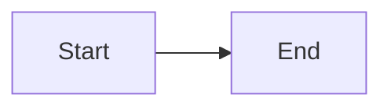

# GFM Fixture

| Feature | Supported |
| ------- | --------- |
| Tables  | yes       |

- [x] Done item
- [ ] Open item

A sentence with a footnote.[^1]

[^1]: The footnote text.

> [!NOTE]
> Useful information.

> [!TIP]
> Helpful advice.

> [!IMPORTANT]
> Key information.

> [!WARNING]
> Urgent information.

> [!CAUTION]
> Risky action.

```swift
func greet(name: String) -> String {
  return "Hello, \(name)"
}
```


