# Nubs

**Keep your coding agents working around the clock, and drop in from any Apple device.**

<p align="center">
  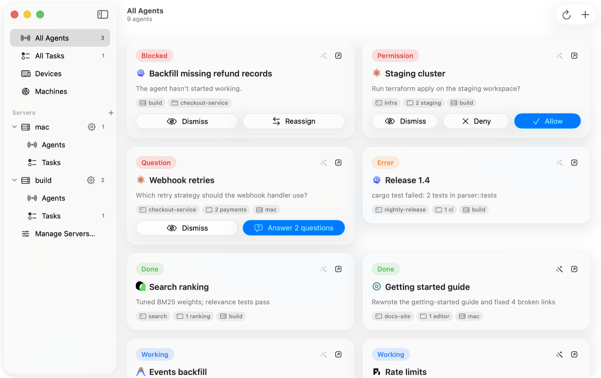
  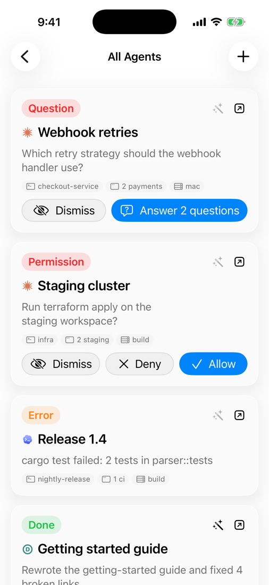
</p>

[Rex](https://www.superlogical.com/rex) is cool. Its handy tab icons show you which agent is working in which tab, and
sessions give you a visual feel for what's being worked on. For everything else, you're pretty much on your own. That
is, unless you put those tiny Jurassic arms to work with Nubs!

Nubs lets you connect your machines, keep an eye on agents, create tasks, scope them, tag them, choose which agents
can work on them, set a priority, and so much more. When you're ready to get things going, just press "Play" and watch
the magic happen as Nubs orchestrates your agents and task boards seamlessly, assigning tasks to agents, making sure
the highest-priority tasks always come first, and keeping every task's status up to date. Or don't watch, that's
completely up to you. Nubs keeps working either way. If an agent needs you, you're always within tiny arms' reach of a
Nubs app, so you can step in and keep things running. It shows every agent on every Rex server you use, Mac or headless
Linux box, in one place, with the ones that need you on top. Answer questions, respond to permission requests, and
review finished work from your Mac's menu bar, your iPhone or iPad, your Apple Watch, or your Apple TV.

Nubs works with Claude Code, Codex, Devin, Cursor, Antigravity, Qoder, Pi and Hermes.

## Every agent, most urgent first

Blocked, failed, done, working and idle agents from all your Rex servers, sorted by what needs you. It lives in your
menu bar, on your desktop as a widget, on your Lock Screen and on your wrist.

<p align="center">
  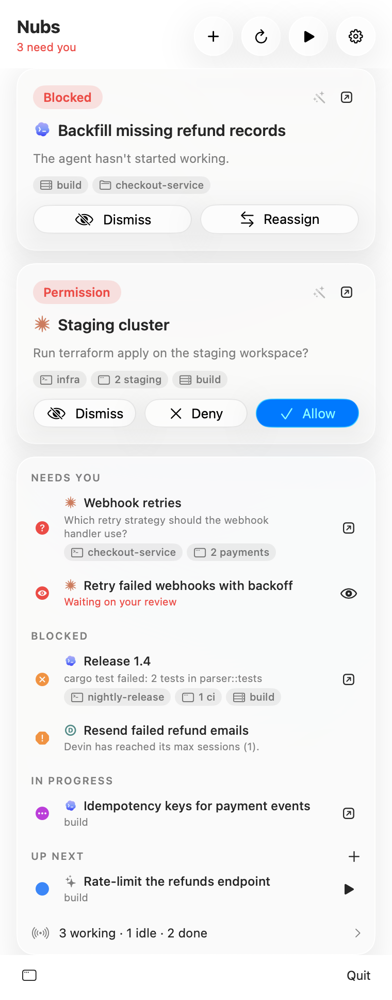
  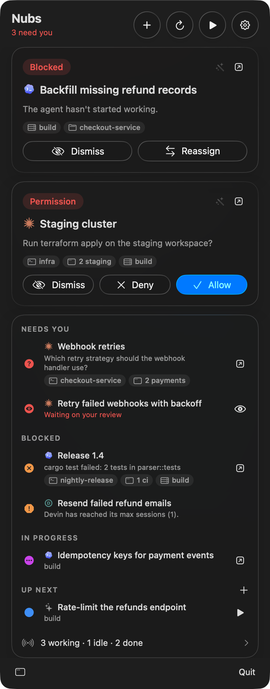
</p>

## Answer and allow from anywhere

An agent asking a question or waiting for permission doesn't have to wait for you to get back to your desk. Pick
the answers or tap Allow on your phone or watch, and Nubs types them into the agent's own terminal. You choose
which devices may answer and allow, in the Mac's Settings.

<p align="center">
  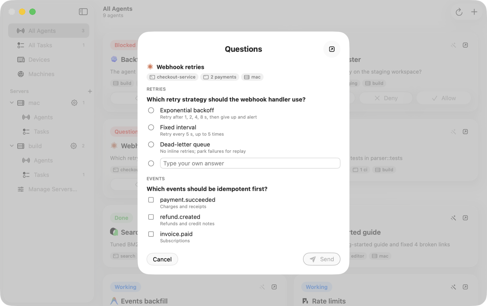
</p>

<p align="center">
  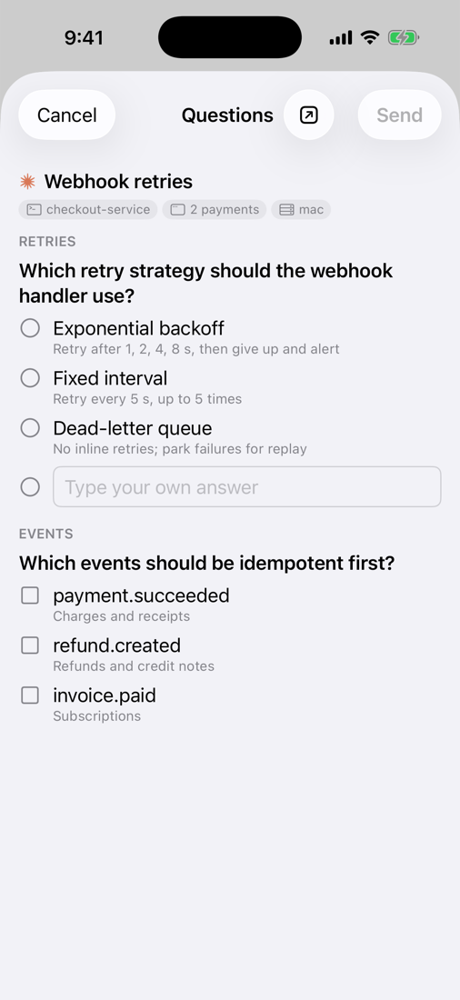
  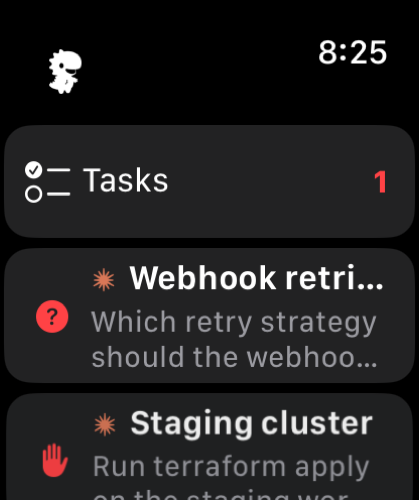
</p>

## Tasks that keep running

Give Nubs a backlog and it keeps your agents busy. By default each task runs in its own git worktree with the
right agent for the job, and waits for your review before anything is merged. Agents can read and manage the board themselves
through the built-in nubs MCP.

<p align="center">
  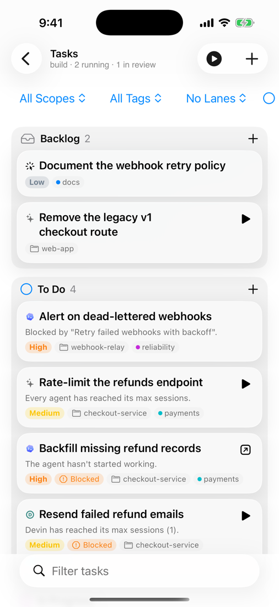
  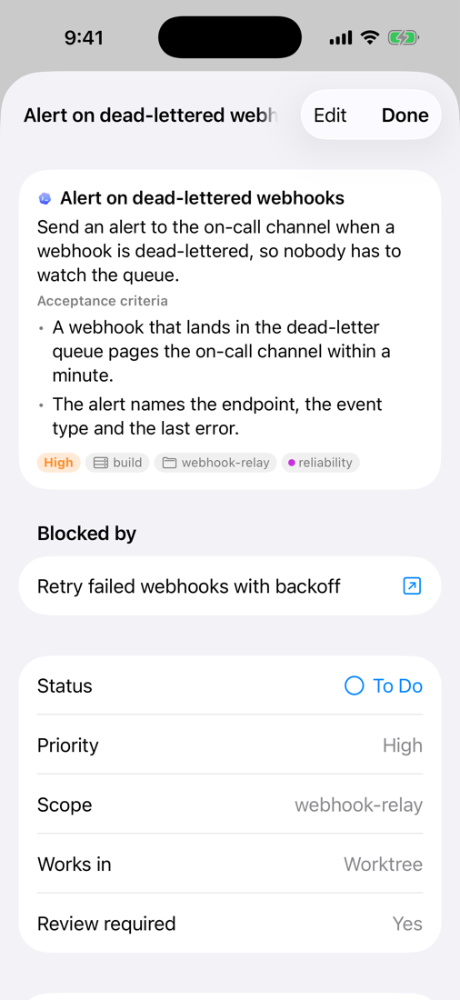
</p>

## All your machines, all your devices

Add every Rex server you use and pair your iPhone, iPad and Apple TV from the Mac. Your Apple Watch comes along with
your iPhone.

<p align="center">
  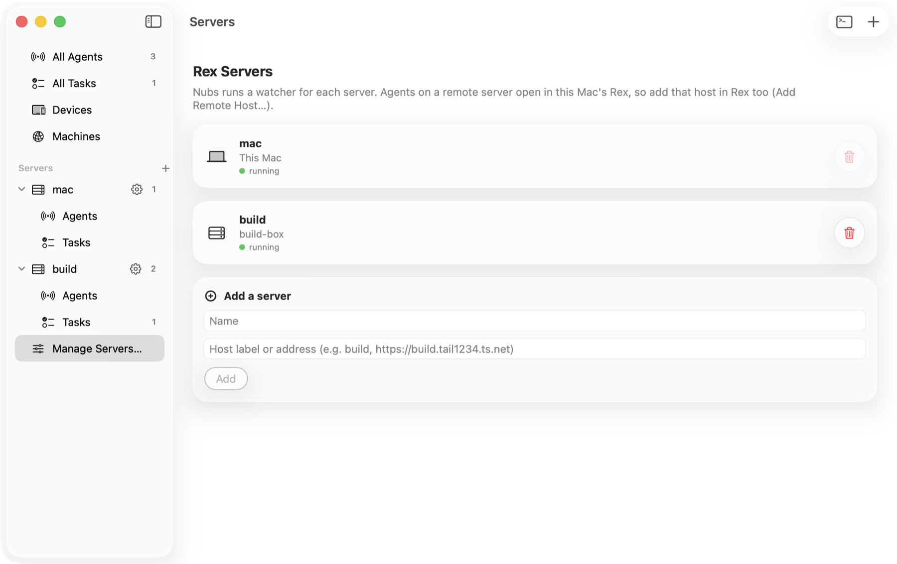
  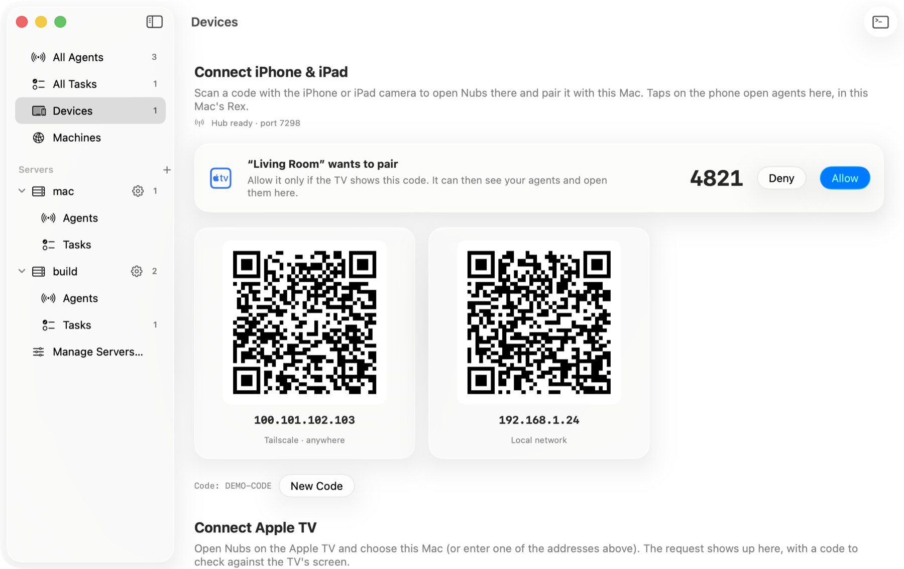
</p>

The apps for iPhone and iPad, Apple Watch and Apple TV are coming to TestFlight. This page will link to them when
they're ready.

## Install

Download **[Nubs.dmg](https://github.com/good-banana/nubs/releases/latest/download/Nubs.dmg)**, open it and drag
Nubs to Applications.

To set up the app, the `nubs` service and your agents' hooks and MCP in one step, run this in Terminal instead.
On a Linux Rex server, the same command installs the `nubs` service there.

```sh
curl -fsSL https://github.com/good-banana/nubs/releases/latest/download/install.sh | sh
```

**Requirements:** [Rex](https://www.superlogical.com/rex) with **Remote Control** turned on in the Rex app's
settings, and macOS 26 or later.

<details>
<summary>Installer options</summary>

Options go after `sh -s --`, for example `curl -fsSL …/install.sh | sh -s -- --agents claude,codex`:

| Option | Effect |
| --- | --- |
| `--agents ID,ID` | Set up only these agents: `claude`, `codex`, `devin`, `cursor`, `qoder`, `antigravity`, `pi`, `hermes`. |
| `--no-hooks` | Leave the agents' Nubs hooks alone. |
| `--no-mcp` | Don't give the agents the nubs MCP. |
| `--version vX.Y.Z` | Install that release instead of the latest. |
| `--dry-run` | Print what it would do, and change nothing. |
| `--uninstall` | Remove everything it installed. |

</details>

## Uninstall

```sh
curl -fsSL https://github.com/good-banana/nubs/releases/latest/download/install.sh | sh -s -- --uninstall
```

This removes the app, the `nubs` service and what Nubs added to your agents, then asks whether to keep your task
history.

## Credits and license

Copyright (c) 2026 good-banana. All rights reserved.

Inspired by [Rex Radar](https://github.com/hecspc/rex-radar) by Hector Sanchez Pajares, and includes portions of its code used under the MIT license; see
[THIRD_PARTY_NOTICES.md](THIRD_PARTY_NOTICES.md). Rex is made by [Superlogical](https://www.superlogical.com/rex).
