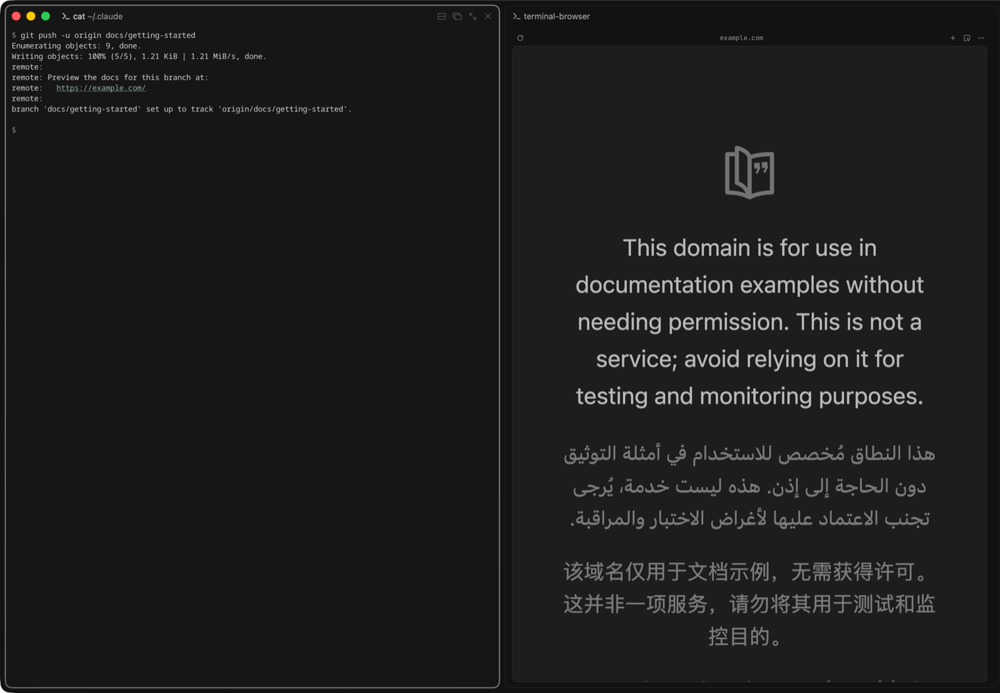

# sideclick

Cmd-click a web link in a Rex terminal pane and it opens in a browser pane right beside it, instead of a separate browser window.



| Gesture in a Rex pane | Opens in |
| --- | --- |
| Cmd-click | Your in-pane browser, in a focused split to the right of the pane you clicked in. With terminal-browser, a link opens as a new tab in a terminal-browser pane already in that Rex tab. |
| Cmd+Option-click | Your previous default browser |

Links opened from any other app go to your previous default browser, unchanged.

## Install

```sh
brew install good-banana/rexworks/sideclick
sideclick setup
```

Setup checks that your in-pane browser is installed, and offers to install it with Homebrew if it isn't. It then installs the small Sideclick app into `~/Applications`, records your current default browser, and makes Sideclick the default for web links. macOS asks you to confirm that change.

Rerun `sideclick setup` after `brew upgrade sideclick` to update the installed app.

Requirements: macOS 14 or later, Swift 6 (Xcode 16 or later Command Line Tools), and [Rex](https://www.superlogical.com/rex).

## Choose a browser

terminal-browser is the default. Change it with `sideclick config`:

```sh
sideclick config set browser w3m
sideclick config set browser lynx
sideclick config set browser terminal-browser
sideclick config set browser custom 'carbonyl {url}'
```

To go back to terminal-browser:

```sh
sideclick config unset browser
```

| Browser | Notes |
| --- | --- |
| [terminal-browser](https://terminal-browser.com) | A full browser in the terminal. Later links open as tabs in the same pane. |
| [w3m](https://w3m.sourceforge.net), [lynx](https://lynx.invisible-island.net) | Text-mode browsers. Each link opens a new pane. |
| Custom | Any command, with `{url}` where the link goes. It runs in your login shell environment, and the link is passed as a single argument, so `{url}` doesn't need quotes. |

Choosing terminal-browser, w3m or lynx checks that it's installed and offers to install it with Homebrew. `sideclick config` shows the current choice.

## Uninstall

```sh
sideclick uninstall
```

This restores your previous default browser (Safari if it's no longer installed), removes the Sideclick app and its settings, and then runs `brew uninstall sideclick` for you. Use it instead of `brew uninstall sideclick` on its own, which can't restore your browser.

## Troubleshooting

```sh
sideclick doctor
```

Each link Sideclick routes, and any error, is logged to `~/Library/Application Support/sideclick/handler.log`. When the in-pane browser can't be opened, the link goes to your previous browser instead.

## Development

```sh
swift build
scripts/build-app.sh .build/debug/SideclickHandler 0.0.0 .build/app
.build/debug/sideclick setup --app .build/app/Sideclick.app
```

To test the formula before tagging, run `sideclick/scripts/release.sh --local X.Y.Z`. It archives the working tree and writes a formula with a `file://` URL to `$TMPDIR/sideclick.rb`, for local testing only. To release, tag `sideclick-vX.Y.Z`, push the tag, and run `sideclick/scripts/release.sh X.Y.Z` to write `homebrew-rexworks/Formula/sideclick.rb`.
